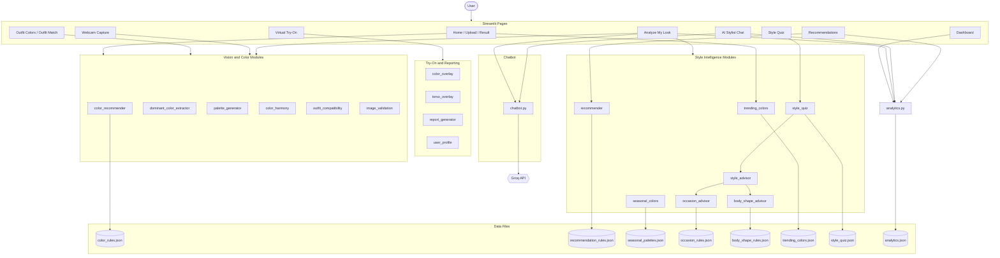
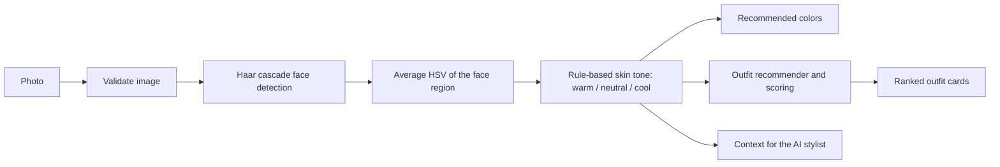

# AI Fashion Color Fit Matcher & Virtual Stylist: Technical Report

**Author:** Rashi Sharma, Sabila Nigar, Preeti Kumari of B.Tech Computer Science & Engineering (core), JIS University
**Repository:** https://github.com/RashiSharma-dev/ai-fashion-stylist
**Live app:** https://ai-fashion-stylist.streamlit.app/

---

## 1. Introduction

Choosing clothes that suit your skin tone is an everyday problem. Most people rely on guesswork, and professional stylists are expensive and not always available. The AI Fashion Color Fit Matcher is a web application that automates this advice. A user takes or uploads a photo, and the system finds the face, classifies the skin tone, and recommends flattering colors and complete outfits. The user can preview a chosen color on their own photo, and can ask an AI stylist chatbot follow-up questions in plain language. The project combines classical computer vision (OpenCV), unsupervised machine learning (K-Means clustering), a transparent rule-based recommendation engine, and a large language model served through the Groq API. It is built entirely in Python with Streamlit, so the whole application runs as one codebase without a separate front end. The project was developed step by step over four phases: foundation and planning, core AI features, advanced features with the chatbot, and polishing, testing, and deployment. Every recommendation can be explained in plain English, which makes the system easy to understand and to defend.

_Viva question answered: "What is your project, and what problem does it solve?"_

## 2. Objectives

1. Detect a face in a photo and classify the skin tone as warm, neutral, or cool.
2. Recommend clothing colors that suit the detected skin tone.
3. Extract the dominant color of a clothing photo and judge whether it suits the user.
4. Recommend complete outfits (top and bottom) filtered by occasion, season, gender, and style, and rank them with an explainable match score.
5. Let users preview a clothing color on their own photo through a virtual try-on.
6. Provide a context-aware AI stylist chatbot that stays on the topic of fashion.
7. Personalize advice using occasion, season, body shape, a style personality quiz, and trending colors.
8. Deliver the system as a polished, responsive, tested web application with usage analytics.

The project is a styling aid for everyday use. It is not a medical or dermatological tool.

_Viva question answered: "What were the goals of your project?"_

## 3. System Architecture

The application has three layers. The first is the **user interface layer**, made of 13 Streamlit pages, such as Analyze My Look, Recommendations, Virtual Try-On, AI Stylist Chat, Style Quiz, Dashboard, and Mirror Mode. The second is the **logic layer**, a set of small Python modules in the `src/` folder, each responsible for one job such as skin tone analysis, outfit scoring, or chatbot prompts. The third is the **data layer**, made of JSON and CSV files in the `data/` folder, such as the color rules, the outfit database, and the seasonal, occasion, and body shape rules. The only external service is the Groq API, which the chatbot module calls to generate replies. Pages never contain heavy logic. They call module functions and display the results, which keeps the code easy to test. All AI and data functions follow one convention: they return a dictionary containing an `error` field, which is empty on success and holds a friendly message on failure, so the interface never crashes on bad input. Streamlit's session state carries the user's latest analysis (skin tone, occasion, body shape, style personality) from the analysis page to the chat pages. Usage counters are saved in a small JSON file and shown on the dashboard.

The main analysis pipeline, from photo to recommendations, looks like this:

_Viva question answered: "Explain the architecture of your system."_

## 4. Modules Explained

| Module | What it does | Key detail |
|---|---|---|
| `color_recommender.py` | Finds the face, classifies the skin tone, and returns recommended colors | Haar cascade face detector, then the average HSV of the face region and simple threshold rules |
| `image_validation.py` | Checks that a photo can be read and is bright enough to analyze | Rejects unreadable files and images with an average brightness below 40 out of 255, with a friendly message |
| `dominant_color_extractor.py` | Finds the main colors of a clothing photo | K-Means clustering with k = 5, on an image resized to at most 300 pixels |
| `palette_generator.py` | Draws a color palette and converts RGB to hex | Uses Pillow |
| `color_harmony.py` | Judges whether two colors look good together | Straight-line (Euclidean) distance in RGB space, plus complementary and analogous pairs from a JSON file |
| `outfit_compatibility.py` | Checks whether an outfit's main color suits the user's skin tone | Compares the outfit's dominant color with the recommended colors |
| `recommender.py` | Picks and scores outfits from the 150-outfit database | Cascading fallback and a weighted score (explained below) |
| `color_overlay.py`, `torso_overlay.py` | Virtual try-on | Estimates the torso from the face position, then blends a color over it with alpha blending |
| `chatbot.py` | AI stylist chatbot | Groq API, a context-aware system prompt, fashion-only scope rules, and a personalized greeting |
| `seasonal_colors.py`, `occasion_advisor.py`, `body_shape_advisor.py`, `trending_colors.py` | Style intelligence | Rules read from JSON files: 4 seasons, 6 occasions, 5 body shapes, and real Pantone Colors of the Year |
| `style_quiz.py`, `style_advisor.py` | Style personality and combined advice | A 5-question quiz leads to one of 3 personas (Classic Minimalist, Bold Maximalist, Boho Chic), which is merged with skin tone, occasion, and body shape |
| `user_profile.py`, `report_generator.py` | Saved profiles and downloadable report | A JSON profile per user, and a one-file HTML style report |
| `analytics.py` | Usage tracking | Counters for photos analyzed, outfits viewed, and chat messages, plus color and occasion counts for the dashboard |
| `theme.py`, `ui_states.py` | Interface system | One 5-color palette and 2 fonts through CSS variables, animations, mobile rules, and friendly empty states |

**How the skin tone is decided.** After the face is found, its pixels are converted from BGR to HSV (hue, saturation, value) and the three channels are averaged. A hue of 20 or less with saturation above 60 is labeled warm. A hue of 20 or less with saturation of 60 or below is labeled neutral. Any higher hue is labeled cool. HSV is used because it separates color (hue) from brightness, which makes the rule less sensitive to how bright the photo is than raw RGB values would be.

**How an outfit is scored.** The recommender first looks for outfits whose top color is recommended for the skin tone and that match the chosen occasion and season exactly. If there are too few, it ignores the season, and if there are still too few, it matches on color alone. The final score is 40% skin match, 30% color harmony, and 30% occasion fit. The skin match is higher when the top color is close to the colors recommended for that skin tone. The color harmony score is low (40) when the top and bottom are too similar, 85 for an elegant combination, and 90 for strong contrast. The occasion fit is 100 for an exact match, 70 when the season was relaxed, and 40 when only the color matched. Because every number comes from a visible rule, the "Why this outfit?" explanation can state the exact reason.

_Viva questions answered: "How does your skin tone detection work?", "How are outfits recommended and scored?", "What does each module do?"_

## 5. Tech Stack with Justification

| Technology | Used for | Why it was chosen |
|---|---|---|
| Python 3.11 | Whole project | Strongest ecosystem for computer vision and machine learning, and easy to read |
| Streamlit | Web interface | Builds a full interactive app in pure Python, with built-in camera, file upload, and session state |
| OpenCV | Face detection, color spaces, image blending | Fast, runs on a normal CPU, and needs no training for the Haar cascade face detector |
| NumPy and Pandas | Image arrays and the outfit table | Efficient array math for pixels, and simple filtering of the CSV outfit database |
| scikit-learn | K-Means clustering | A reliable, well-tested implementation for finding dominant colors |
| Pillow | Palette images and image conversion | Simple drawing and format conversion |
| Matplotlib | Dashboard charts | Full control over chart colors to match the app theme |
| Groq API (model `openai/gpt-oss-20b`) | AI stylist chatbot | Fast replies and a free tier, with no local GPU needed |
| python-dotenv | Secret management | Keeps the API key in a `.env` file that is never committed to GitHub |
| pytest | Unit tests | Simple, readable tests that run with one command |
| Git and GitHub | Version control | Full history of every day's work, and a public portfolio |

Skin tone is classified with explainable rules instead of a trained deep neural network. This was a deliberate choice: no labeled skin tone dataset or GPU was available, the rules run instantly, and every decision can be explained. The trade-off is lower robustness, which is discussed in the limitations.

_Viva question answered: "Why did you choose these technologies?"_

## 6. Testing

The project is tested at three levels. First, **14 automated unit tests** written with `pytest` check the core logic. They cover the three skin tone classes, the error dictionary returned for a missing photo, the recommender's output and its 40/30/30 scoring formula, color conversion and distance, and the harmony labels "Great Contrast" and "Too Matchy", and the offline fallback replies used when the AI service is unavailable. Second, a **manual full-flow test** walks through one complete user journey: the style quiz, the skin tone analysis, the chatbot greeting, recommendations with a report download, the virtual try-on, Mirror Mode, and the dashboard. Third, there are **quality checks**: a UI audit of all 13 screens, a mobile-responsiveness check on phone-sized screens, and a custom code audit tool that confirms every function has a docstring and that no debug print statements remain. Error handling is tested by design, because every AI function returns an error dictionary instead of raising an exception to the user. During testing, one real bug was found and fixed: the outfit compatibility check crashed when a selfie had no detectable face, because it tested for `None` while the function actually returned an error dictionary. A formal accuracy benchmark for skin tone detection against expert-labeled photos has not been run yet, and is listed under future scope.

_Viva question answered: "How did you test your project?"_

## 7. Limitations

1. **Skin tone detection is simple.** It uses the average HSV of the face with fixed thresholds, so it is sensitive to lighting, camera white balance, makeup, and photo filters. It outputs only three categories and is not a clinically validated skin tone scale. During testing, a hue wrap-around error was found (red sits at both ends of the hue scale, so a plain average can land on green) and was fixed with a wrap-aware average, but the thresholds are still not calibrated on a labeled dataset.
2. **Face detection is limited.** The Haar cascade works best on well-lit, front-facing faces and can fail with side angles, masks, or very small faces.
3. 3. **The outfit database is small and synthetic.** It holds 150 outfits created by a script that randomly combines top colors, bottom colors, occasions, seasons, styles, and genders (with a fixed random seed so the data is repeatable). These are not real products from a store, and not every combination is a curated look.
4. **Body shape is self-selected.** Reliable automatic detection needs full-body pose estimation, which the project does not use.
5. **The virtual try-on is basic.** It tints an estimated torso rectangle with a flat color, so it does not follow the real outline of clothing or show fabric texture.
6. **The chatbot depends on an outside service.** Model names on the Groq free tier can change, which already forced two model updates during development, and the "fashion only" rule is enforced by the prompt rather than by a hard filter.
7. **Camera capture takes single photos.** It is not continuous video, and phone browsers allow camera access only over HTTPS.
8. **Data storage is simple.** Profiles and usage counts live in local JSON files, with no user accounts, so a hosted version shares those files between visitors and may reset them when the server restarts.
9. **Accuracy has not been formally measured** on a labeled photo set.

_Viva question answered: "What are the limitations of your project?"_

## 8. Future Scope

1. **Better skin tone model.** Evaluate on a labeled, diverse dataset, calibrate the thresholds, and consider a trained model, with a fairness check across different skin types and lighting.
2. **Pose estimation.** Use a library such as MediaPipe to detect body shape automatically and to place the try-on color on the real clothing area.
3. **Realistic try-on.** Add image segmentation of clothing so that colors and fabrics follow the real garment.
4. **Live video.** Replace single-photo capture with continuous camera video in Mirror Mode using `streamlit-webrtc`.
5. **Real products.** Connect to a product catalog so recommendations link to items that can be bought.
6. **User accounts and a database.** Store profiles, wardrobes, and analytics per user in a proper database such as SQLite or PostgreSQL.
7. **Wardrobe mix-and-match.** Let users photograph their own clothes and receive outfit combinations from what they already own.
8. **More languages and voice.** Support Hindi and other languages in the chatbot, and voice input.

_Viva question answered: "How can this project be improved?"_

## 9. Conclusion

The AI Fashion Color Fit Matcher shows that a useful styling assistant can be built from a small set of well-understood techniques: face detection, color-space analysis, clustering, transparent scoring rules, and a language model with clear boundaries. The system turns one photo into skin tone analysis, outfit recommendations, a color preview, and a conversation with an AI stylist. Its modular design, automated tests, and consistent error handling make it easy to extend. The main areas to strengthen next are the accuracy of skin tone detection and the realism of the virtual try-on.
